# Contribution Fireworks

Turn your GitHub contribution calendar into a fireworks show for your profile README.

<picture>
  <source media="(prefers-color-scheme: dark)" srcset="https://raw.githubusercontent.com/Daucloud/contribution-fireworks/output/seasons/fireworks-dark.svg" />
  
</picture>

Each day you contributed launches a rocket that bursts over its square. The busier the day, the bigger and brighter the burst. Colors follow the seasons: frost blue in winter, sakura pink in spring, gold in summer, maple red in autumn. Once the whole year is lit it holds for a moment, fades out and starts over.

## Setup

**1. Add a workflow** to your profile repository (`<you>/<you>`), e.g. `.github/workflows/fireworks.yml`:

```yaml
name: Contribution fireworks

on:
  schedule:
    - cron: "0 0 * * *"   # once a day
  workflow_dispatch:

permissions:
  contents: write

jobs:
  fireworks:
    runs-on: ubuntu-latest
    steps:
      - uses: Daucloud/contribution-fireworks@v1
```

**2. Run it once** from the Actions tab (*Contribution fireworks → Run workflow*). It pushes the SVGs to an `output` branch, so your `main` branch stays untouched.

**3. Add it to your README**, replacing `USERNAME`:

```html
<picture>
  <source media="(prefers-color-scheme: dark)" srcset="https://raw.githubusercontent.com/USERNAME/USERNAME/output/fireworks-dark.svg" />
  
</picture>
```

The `<picture>` tag serves the dark version to visitors using GitHub's dark theme.

## Options

```yaml
      - uses: Daucloud/contribution-fireworks@v1
        with:
          palette: gold
```

| Input | Default | Description |
|---|---|---|
| `palette` | `seasons` | `seasons`, `gold` or `rainbow` |
| `github_user_name` | repository owner | Whose contributions to draw |
| `output_branch` | `output` | Branch the SVGs are pushed to. It is overwritten on every run, so don't point it at a branch you use. |
| `github_token` | `${{ github.token }}` | Token used to read the calendar and push the SVGs |

## Palettes

**gold**

<picture>
  <source media="(prefers-color-scheme: dark)" srcset="https://raw.githubusercontent.com/Daucloud/contribution-fireworks/output/gold/fireworks-dark.svg" />
  
</picture>

**rainbow**

<picture>
  <source media="(prefers-color-scheme: dark)" srcset="https://raw.githubusercontent.com/Daucloud/contribution-fireworks/output/rainbow/fireworks-dark.svg" />
  
</picture>

## How it works

- `fireworks.py` reads your calendar from the GitHub GraphQL API and writes two SVGs, one light and one dark. It needs only the Python standard library, so the action runs without installing anything.
- The animation is plain SVG with CSS keyframes: no JavaScript and no external service, so it keeps working inside GitHub's image proxy.
- Busy calendars don't turn into a wall of sparks. Up to 60 active days, every day gets a firework. Past that, only the brightest days launch, never two neighbours at once, and the rest light up with a gentler pop.
- The default token only sees public activity. To include private contributions, turn on *Include private contributions on my profile* in your GitHub profile settings.

## Run locally

```bash
GITHUB_TOKEN=$(gh auth token) python3 fireworks.py USERNAME out --palette seasons
```

## License

MIT
